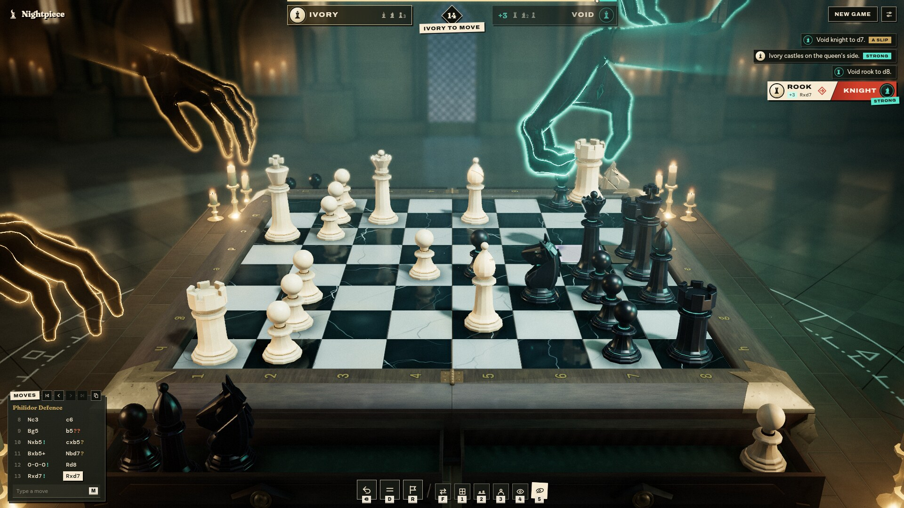
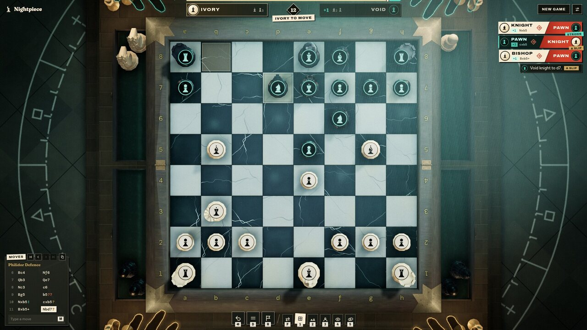
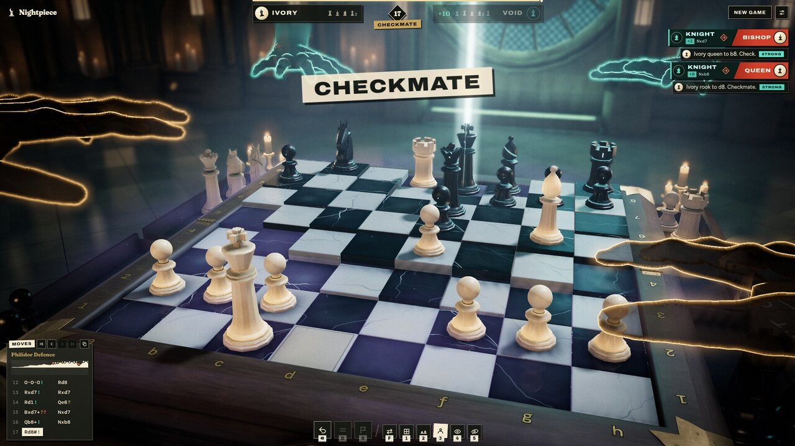
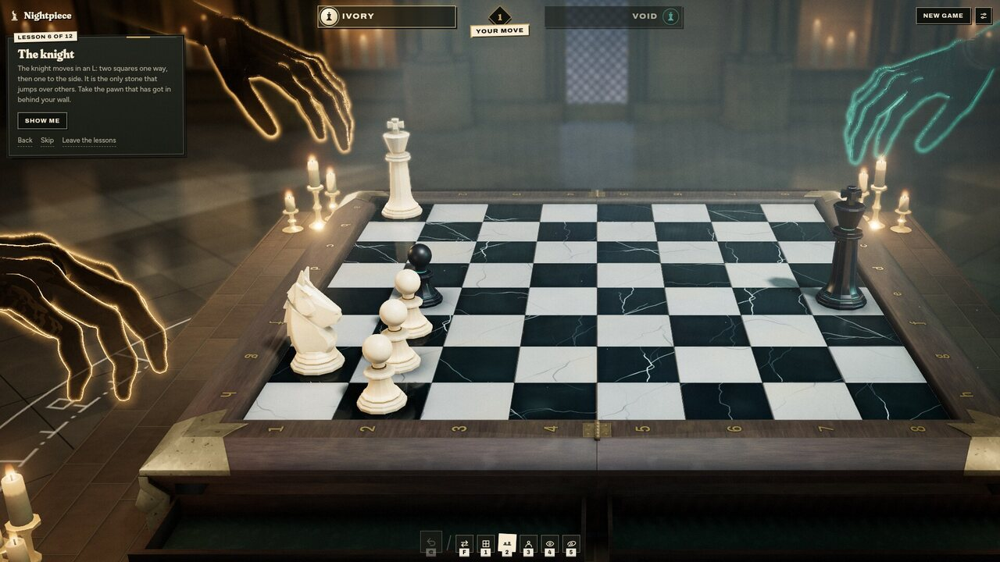

# Nightpiece

Nightpiece is a 3D chess game that runs in the browser. Each player is a pair of spectral hands that reaches into a candlelit chapel and moves living stone pieces by hand, on a board that unfolds from a brass-bound case when the game begins. The pieces and the room react to the game: a threatened piece flinches, check makes the king afraid, and mate gets a set piece of its own.

**Play it:** <https://playnightpiece.com>

[](https://github.com/rndaom/nightpiece/actions/workflows/ci.yml)



| The view from above | Checkmate | A lesson |
|---|---|---|
|  |  |  |

## What you can do

- **Play a friend online** through a link. The game makes a private room; anyone else with the link watches.
- **Find a ranked match** against a stranger: ten minutes a side plus five seconds a move, ratings, no account.
- **Play the computer** at six levels, from First game to Master (Stockfish, running in the browser).
- **Play someone beside you** at the same screen.
- **Learn the game** in twelve short lessons at the board, with hints, a warning before a blunder, and each rule explained the first time it comes up. Every kind of help can be turned off.

Full chess rules (castling, en passant, promotion, and the FIDE draw rules: threefold and fivefold repetition, the fifty- and seventy-five-move rules, insufficient material), five cameras, PGN export, takebacks against the computer, and a game against the computer that survives closing the page.

## Run it

Needs Node 22.12 or newer.

```bash
npm install
npm run dev
```

Then open <http://127.0.0.1:5173>. For online play while developing, run the game's server beside the dev server (the dev server passes connections on to it):

```bash
npm run server
```

Other commands:

| Command | What it does |
|---|---|
| `npm test` | The rules, camera, animation, hand, asset, engine, server, lesson and controller tests. The engine tests run the real Stockfish, the server tests real sockets |
| `npm run typecheck` | Type-checks the game, the server, the tools and the tests |
| `npm run build` | Type-checks and writes the production build to `dist/` |
| `npm run serve` | Serves `dist/` (so build first) and the online rooms from one server, on <http://127.0.0.1:8787> (`npm start` is the same) |
| `npm run look` | Drives the dev build in headless Chromium and saves a fixed tour of frames to `tmp/look/` (needs `npm run dev` running and a Chromium or Chrome; see `tools/dev/look.mjs`) |

## Hosting it

The server holds each online game and checks every move. By default it answers only on the machine it runs on; `npm run serve -- --host 0.0.0.0` lets other machines on the network join. A host that stops the server with a signal should start it as `node --import tsx server/main.ts` and not through npm, which does not always pass the signal on; the server then writes its games down before it stops. Settings can be given on the command line or in the environment:

| Setting | Default | Meaning |
|---|---|---|
| `PORT`, `HOST` | `8787`, `127.0.0.1` | Where the server listens |
| `ALLOW_ORIGIN` (`--allow-origin`) | none | Further origins, comma-separated, that may open a connection. A page on the server's own host is always allowed; browsers from any other origin are refused |
| `DATA_DIR` (`--data`) | `data/` beside the server | Where the scores and games in progress are kept. On a host, point it at storage that outlives a restart |
| `BEHIND_PROXY=1` | off | Count visitors by the address the proxy gives (`X-Real-IP`, or the last in `X-Forwarded-For`) |
| `PER_ADDRESS` | 60 | The most connections one address may hold. An IPv6 visitor is counted by their /64 block |
| `MAX_ROOMS` (`--max-rooms`) | 1000 | The most rooms, ranked and friendly together |

Games in progress are written to `rooms.json` and a journal in the data folder as they change, so a game survives a restart or a crash; the clocks stand still while the server is down, and each player has the usual minute to come back. Seat secrets are stored only as hashes. A file `blocked-names.txt` in the data folder, one word to a line, rules out player names beyond the built-in checks. Those words, the hard slurs the game refuses by itself, and the few names reserved for the game itself, are refused however they are written: with another alphabet's letters, or with digits for letters.

The server keeps a count, by day, of how far visits go: pages opened, first visits and returns on a later day, the board drawn, each kind of game begun, a move made, ten moves made, a game finished, and a minute, five and fifteen in sight; and of ranked games matched, rated and called off, and games between friends begun. A page sends only the name of each step, once, to `/api/event`. A link to the game may say where it was posted (`https://playnightpiece.com/?from=forum`, a word of up to sixteen small letters and digits), and a visit that comes by it is counted under that word too, which is then taken out of the page's address. A browser that says a program is driving it counts nothing. No address, cookie, name or anything else that tells one visitor from another is kept (an address is held in memory for an hour, only to stop it counting without end). The counts are in `stats.json` in the data folder, and each hour's are written to the server's log. `/api/lobby` says how many are waiting for a match and how many are playing, which the choice of game shows.

The server sends a strict Content-Security-Policy (everything from the server itself, WebAssembly allowed for the engine, the one inline style allowed by its hash), refuses to be framed, sends no referrer, turns off the camera, microphone and similar features, and asks for HTTPS when a proxy says the visitor came over HTTPS. It compresses what it sends, drops a connection that stops reading, and rate-limits whole-room requests.

## Ranked play

**Find a match** pairs a player with whoever has waited longest. Nobody signs up: each browser makes a secret for itself and keeps it, the player may choose a name, and the server knows them by a hash of that secret. Clearing the browser's storage, or playing from another browser, makes a new player.

- Ten minutes a side and five seconds back a move, kept by the server. Ivory's clock starts four seconds after both players are at the board, or at Ivory's first move if that is sooner.
- Running out of time, or leaving for more than a minute, loses, unless the other side could never mate with what it has left, when the game is drawn (FIDE 6.9).
- Until both players have made a move nothing is at stake: a game abandoned before then is called off and no rating moves. Each player has forty-five seconds at the board to make a first move, counted down on screen; one who makes none has the game called off. A player or address that causes two called-off games within ten minutes waits ten minutes before looking for another.
- Repetition and fifty-move draws may be claimed by the player to move; the server checks the claim. A fifth repetition or seventy-five moves ends the game by itself.
- No one is paired with themselves, with someone at the same address, or with someone they have already played three rated games with in the last day. Two addresses that have finished six rated games between them in a day are not paired again that day, whoever is playing.
- Ratings start at 1200, and the rankings list players with at least three games. A game through a link is friendly: no rating, a rematch with colours swapped, and a clock only if the players choose one (3+2, 5+3, 10+5, 15+10 or 30+0). A ranked game has no rematch; the next one comes from the queue.
- The scores are one file, `scores.json`, in the data folder.

None of the engine's help is given in an online game while it is being played, nor anything that would point out a tactic; spectators are given no more. Once the game is over it can be reviewed like any other.

## Controls

| Key | Action |
|---|---|
| Click, or drag | Pick a piece and put it on a lit square. Marked squares are moves, ember brackets are captures, a violet hatch marks a square where the piece would be lost |
| `1` to `5` | Cameras: Top, Side, Shoulder, Eyes, Orbit. In Orbit, drag to look around and scroll or pinch to zoom |
| `F` | Sit on the other side of the board |
| `H` | Hint: the piece to move; asked again, where and why |
| `Backspace` | Take back a move (not online) |
| `M`, then `Enter` | Type a move (`Nf3`, `exd5`, `O-O`, `e8=Q`, or `g1f3`) |
| `R`, `D` | Resign, offer or claim a draw |
| Arrow keys, `Home`, `End` | Step through the game's record |
| `P` | Hide the interface |
| `Esc` | Put a piece down, leave the record, bring the interface back |

A whole game can be played from the keyboard. On a touch screen a tap picks the nearest piece you can move, and a carried piece is held a little above the finger. Settings has the picture quality (Low, Medium, High or Auto, which steps down by itself on a slow machine), three volumes, the cinematic camera, and each kind of help. When the system asks for reduced motion the camera stays still unless the cinematic camera is turned on.

## How it is built

- **TypeScript, Vite, Three.js and Preact.** Post-processing (bloom, depth of field, film grain) and the materials are written for this game.
- **Rules** come from [chess.js](https://github.com/jhlywa/chess.js), shared between the browser and the server.
- **The engine** is [Stockfish](https://stockfishchess.org/) 19 compiled to WebAssembly, run unmodified in a Web Worker and spoken to over UCI; `engine/SOURCE.txt` in the build says where its source is. It plays the computer's moves and judges every move played, which drives the pieces' reactions.
- **The hands** are one rigged hand built in Blender and mirrored. Grips are fitted to each piece's shape at run time and the fingers are posed by a solver, so every carry, capture and castle is computed, not a canned animation.
- **Every model and texture** is generated by Python scripts run headless in Blender, so all of it can be rebuilt from source. Textures are synthesised from noise; no scans, photographs or asset packs are used.
- **Every sound** is cut, tuned and layered from CC0 recordings by a Python script, and placed in the room with the chapel's echo by the Web Audio API.
- **The server** is a small Node WebSocket server (`ws`), authoritative on game state: rooms, seats, reconnecting, spectators, clocks and ratings.

## Layout

| Path | What it holds |
|---|---|
| `src/core/` | Rules, on top of chess.js. No rendering code; shared with the server |
| `src/engine/` | The chess engine in a worker: the computer's moves at each level, and a verdict on every move |
| `src/net/` | Online play: the messages, and the connection to the server |
| `src/learn/` | The lessons, and the plain-language text for rules, hints and blunders |
| `src/scene/` | The Three.js scene: chapel, pieces, materials, square markers, post-processing, animation |
| `src/hands/` | The hands: skeleton maths and finger solver, the material, grips and the choreography of a move |
| `src/life/` | How the room answers a move: the pieces, the board, the light and the sound |
| `src/audio/` | Sound placed in the room, the chapel's echo, the mix |
| `src/camera/` | The five views, transitions and the cinematic director |
| `src/app/` | Controller and interface state |
| `src/ui/` | The interface drawn over the scene |
| `server/` | The game's server |
| `assets/src/` | Blender scripts that build every model and texture |
| `assets/src/sound/` | The script that builds every sound from recordings, and the list of those recordings |
| `public/assets/` | What those scripts produce: GLB models, JPEG textures, the sound files |
| `tests/` | Tests, including tests that read the built assets (a few more sit beside the code they test, as `*.test.ts`) |
| `docs/` | The design documents: the style bible, the hands' manners, and the one-page visual direction |
| `tools/dev/` | Headless capture of frames and sound from the running game, and the script that copies the engine into `public/engine/` |
| `tools/promo/` | The scripts that film the promotional videos from the game itself, and the edit that cuts them to music and draws their titles (`tools/promo/film/`, with its own packages) |

## Rebuilding the assets

The built models, textures and sounds are in the repository, so this is only needed after changing a script in `assets/src/`.

**Models and textures** need Blender 5.2 or newer; nothing is opened on screen. Set `BLENDER` to your Blender executable, then from the project folder:

```bash
"$BLENDER" -b --factory-startup -P assets/src/textures.py -- --out public/assets/tex
"$BLENDER" -b --factory-startup -P assets/src/pieces.py -- --out public/assets
"$BLENDER" -b --factory-startup -P assets/src/environment.py -- --out public/assets
"$BLENDER" -b --factory-startup -P assets/src/hands.py -- --out public/assets
```

The pieces and the room bake their occlusion and light with Cycles and take a few minutes each. `npm test` then checks the results against what the game expects.

**Sounds** need Python with NumPy, SciPy and soundfile, and LAME for the MP3 loops. The source recordings are not kept in git; the first command fetches them (listed with their sources and checksums in `assets/src/sound/sources.json`), the second builds `public/assets/sound/`:

```bash
python assets/src/sound/fetch.py
uv run --with numpy --with scipy --with soundfile python assets/src/sound/build.py
```

## Originality

Everything in the game is original work. The look is inspired by Valve's Deadlock and its hero Solomon; no models, textures, audio, logos, typefaces, names or likenesses from that game are used. This project is not affiliated with or endorsed by Valve. Deadlock is a trademark of Valve Corporation.

## Licence

The source code is under the [MIT licence](LICENSE). The art, the sound, the design documents and the name are not: they are all rights reserved, as set out in [LICENSE-ASSETS.md](LICENSE-ASSETS.md). Third-party libraries, typefaces, recordings and the Stockfish engine (GPL-3.0) keep their own licences, listed with their sources in [CREDITS.md](CREDITS.md).
