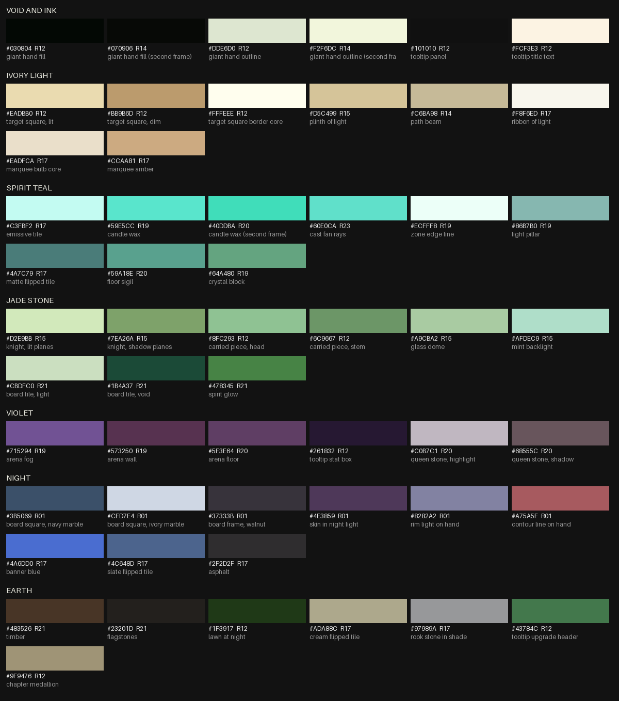

# Style bible

The game is **Nightpiece**. It was called *Mortmain* ("dead hand") while this was written on 10 November 2026, and the text below keeps that date: where it says something is not built yet, check the code, as the game has moved on since.

This document records what the reference actually looks like, where each observation came from, and how this project translates it into an original look. It reads with the one-page [visual direction](visual-direction.html).

## How to read this

Every claim is one of three kinds, and the text says which.

- **Observed**: seen in frames cut from the reference video. Each observation cites frame IDs like `R12`. The frame index is in [section 12](#12-frame-index).
- **Sourced**: it comes from a web page read on 10 November 2026. Links are inline and collected in [section 13](#13-sources).
- **Ours**: a design decision for this game.

Reference video: "Solomon: Deadlock Hero Spotlight" by Dead Air, uploaded 10 October 2026, 9 min 32 s, 4K at 60 fps (<https://www.youtube.com/watch?v=H_DpKG583yo>).

What was extracted from it:

| Pass | Rate | Frames | Purpose |
|---|---|---|---|
| Overview | 2 per second, whole video | 1,144 | Map the video, find every hand and effect moment |
| Dense, hands and casting | 15 per second, 10 segments | 1,645 | Gesture timing |
| Dense, ability effects | 10 per second, 8 segments | 1,635 | Effect anatomy and timing |

What was looked at: all 1,144 overview frames, as contact sheets. From the dense set, about 750 frames: the core of each of the ten hand passages at 5 to 15 frames per second, and four effect passages (the queen's slam and leap, the rooks' wind-up and crossing) at 10 per second. The remaining dense frames are on disk for the build milestones. 26 frames were pulled as the cited set, and colours were measured from those with a script, not picked by eye.

The sourced facts used below were re-read at their sources after the research pass: the stylesheet colours, font roles and textures, Valve's release post and update-site text, the wiki pages, the patch notes and their one quoted line, the Steam discussion and the press descriptions.

**The frames are third-party footage.** They are kept on the author's disk under `docs/reference/frames/` for study, are not in the repository, and never ship with the game; this document refers to them by their ids (`R01` and so on, see section 12). `python tools/reference/build_reference.py all` rebuilds them from the video, and `python tools/reference/sample_palette.py` re-measures the palette.

**Two limits on this study.** First, the study cannot judge sound: the video's soundtrack is narration over music (spectrograms of four ability moments show one dense continuous mix, with no isolated effect sounds to read). The sound section therefore rests on written sources and on design intent. Second, Valve has published no art bible, no artist commentary and no concept art for this hero, so "why" is inferred from "what".

## 1. Thesis

A séance held in a concrete chapel. Two unseen players reach in with hands made of night, and the stone they move is alive and a little afraid of them.

Three pillars:

1. **The hand is the star.** Every move is performed by a pair of spectral hands that arrive as an outline, fill with night, grip the real shape of the piece and let go with a flourish.
2. **Stone that is alive.** Pieces are small brutalist towers of stacked blocks held together by light. Seams breathe. One glowing aperture works as an eye.
3. **Light carries the rules.** Legal squares, threats, paths and payoffs are drawn on the slab in flat, hard-edged light.

Where each part comes from:

| Part of the brief | From the reference | Ours |
|---|---|---|
| Occult magic | Silhouette hands, lit squares, mint spirit light, candles, sigils, violet for the decisive moment | How they map to chess events |
| Brutalist | Nothing. The reference is deco, noir and carved classical stone | The chapel, the slab, the stacked-block pieces |
| Living pieces | A unit breaking into blocks and reassembling as a knight (`R16`) | Seams, eyes, breathing, flinching |
| Puppeteer | A giant hand pinching a piece from above (`R12`) | Threads, human scale, real grips, two players' hands |

## 2. The reference in brief

**Sourced.** Solomon is a chess-hustler mage added to Valve's Deadlock on 9 October 2026 as part of the City Never Sleeps update ([Valve's release post](https://store.steampowered.com/news/app/1422450/view/703281660030879519), [update site](https://www.playdeadlock.com/cityneversleeps)). His weapon is a floating chessboard. His four abilities place giant chess pieces in the world and then move them as chess pieces move: a bishop that arms diagonal squares, a knight that carries an ally, a pair of rooks that travel in a line, and a queen that crashes down and then fires along ranks, files and diagonals ([community wiki](https://deadlock.wiki/Solomon)). A separate "move piece" input picks a placed piece up and sets it down elsewhere.

**Sourced.** Deadlock's world is an alternate early-twentieth-century New York with the occult in plain sight; the wiki calls it urban fantasy with noir, gothic and dieselpunk elements ([wiki](https://deadlock.wiki/Deadlock)). The look has been overhauled several times, most recently on 29 September 2026, so older write-ups describe a superseded game.

**Observed.** The single most useful thing in the footage for this project: when a placed piece is moved, a giant flat black hand with a thin pale outline reaches down from above and pinches the piece by its top (`R12`, `R14`, `R15`, `R16`). It is drawn in the 3D scene, not added by the video's editor: it sits behind and in front of other effects in third-person shots.

| R12 · 4:29 | R15 · 5:01.5 |
|---|---|
| R12, giant hand pinch topdown | R15, dome crest plinth |

## 3. Colour

### 3.1 Measured from the frames

Median colour of hand-picked regions; thin glowing features use the brightest few percent of their region. Full list with boxes and methods: [`reference/palette.json`](reference/palette.json). Swatches: [`reference/palette-sampled.png`](reference/palette-sampled.png).

| Family | What | Hex | Frame |
|---|---|---|---|
| Void and ink | Giant hand fill | `#030804`, `#070906` | R12, R14 |
| | Giant hand outline | `#DDE6D0`, `#F2F6DC` | R12, R14 |
| | Tooltip panel, title text | `#101010`, `#FCF3E3` | R12 |
| Ivory light | Target square, lit / dim | `#EADBB0` / `#BB9B6D` | R12 |
| | Target square border core | `#FFFEEE` | R12 |
| | Plinth of light, path beam | `#D5C499`, `#C6BA98` | R15, R14 |
| | Ribbon of light | `#F8F6ED` | R17 |
| | Marquee bulbs, core / amber | `#EADFCA` / `#CCAA81` | R17 |
| Spirit teal | Emissive tile | `#C3FBF2` | R17 |
| | Candle wax | `#59E5CC`, `#40DDBA` | R19, R20 |
| | Cast fan rays | `#60E0CA` | R23 |
| | Zone edge line | `#ECFFF8` | R19 |
| | Matte flipped tile, floor sigil | `#4A7C79`, `#59A18E` | R17, R20 |
| Jade stone | Knight, lit / shadow planes | `#D2E9BB` / `#7EA26A` | R15 |
| | Carried piece | `#8FC293`, `#6C9667` | R12 |
| | Board tile, light / void | `#CBDFC0` / `#1B4A37` | R21 |
| Violet | Arena fog, wall, floor | `#715294`, `#573250`, `#5F3E64` | R19, R20 |
| | Tooltip stat box | `#261832` | R12 |
| | Queen stone in violet light | `#C0B7C1` / `#68555C` | R20 |
| Night | Board squares, ivory / navy marble | `#CFD7E4` / `#3B5069` | R01 |
| | Board frame, walnut | `#37333B` | R01 |
| | Skin, rim light, contour line | `#4E3859`, `#8282A2`, `#A75A5F` | R01 |
| | Banner blue, asphalt | `#4A6DD0`, `#2F2D2F` | R17 |
| Earth | Timber, flagstones, lawn | `#483526`, `#23201D`, `#1F3917` | R21, R12 |

Whole-chapter clustering (k-means over about 40 evenly spaced frames of each chapter; values in [`reference/palette-chapters.json`](reference/palette-chapters.json)) gives the same story at lower resolution: shadows are warm near-blacks (`#1D1611`, `#22140E`, `#1F1B14`), mid-tones are umbers (`#40372D`, `#64513B`), and saturated colour is a small share of any frame. In the knight chapter the cream of the lit squares is 7% of pixels; in the violet arena the mint is 4%.

### 3.2 From the game's own files

**Sourced.** The game's shipped UI stylesheet, as mirrored by SteamDatabase, names its colours ([citadel_base_styles.css](https://github.com/SteamDatabase/GameTracking-Deadlock/blob/master/game/citadel/pak01_dir/panorama/styles/citadel_base_styles.css)): off-white `#FFEFD7`, off-black `#10130D`, brand green `#5FE69E`, soul colour `#70F8C1`, team amber `#D4860B`, team blue `#4D75C3`, enemy red `#D73232`, spirit purple from `#E7C8FF` down to `#362147`, and a per-hero accent for this hero's codename of `#AA9E7E`. These agree with the measurements: cream on warm near-black, a mint "soul" green, purple for spirit damage.

### 3.3 What the colour is doing

**Observed.**

- Near-black is always warm or green-tinted, never neutral. The hand fill is `#030804`, not `#000000`.
- Cream and gold mean "a square you can act on". Mint and teal mean "spirit is present". The two appear together but do different jobs (`R12`, `R15`).
- Violet appears in one place only: the arena used to show the ultimate (`R19`, `R20`). Everywhere else is amber practical light against teal and blue shadow (`R17`, `R26`).
- Flat colour dominates. Debris, tiles and ribbons are clean, unshaded polygons in three or four values (`R17`, `R19`, `R22`).

| R17 · 5:36 | R19 · 7:05 |
|---|---|
| R17, rook ribbons flipping tiles | R19, queen eruption |

*R17 (5:36): ribbons, flipped tiles, amber against blue. R19 (7:05): the violet arena.*

### 3.4 Ours

Four families, each with one job.

| Family | Name | Hex | Job | Origin |
|---|---|---|---|---|
| Ground | Soot | `#0C0B09` | Shadow, page ground | Derived from the warm shadows |
| | Formwork | `#25231F` | Chapel walls | Ours |
| | Concrete | `#57534B` | Slab in light | Ours |
| | Dust | `#A39D8D` | Haze, secondary text | Ours |
| Ivory side | Bone | `#ECE3CC` | Limestone pieces, text | Near sampled `#FCF3E3` |
| | Candle | `#EADBB0` | Lit square | Sampled, R12 |
| | White heat | `#FFFEEE` | Square border | Sampled, R12 |
| | Gilt | `#C9A45C` | Ivory seams and hand rim | Derived from marquee amber |
| Void side | Void | `#050806` | Hand fill | Sampled, R12 and R14 |
| | Deep | `#1B4A37` | Inside of void tiles | Sampled, R21 |
| | Spirit | `#59E5CC` | Void seams and hand rim | Sampled, R19 |
| | Pale spirit | `#C3FBF2` | Hot core of spirit light | Sampled, R17 |
| Consequence | Violet | `#715294` | Threat and check | Sampled, R19 |
| | Plum | `#2A1B33` | Fog under check | Derived |
| | Ember | `#D0634A` | Capture | Ours |
| | Old blood | `#A75A5F` | Blunder | Sampled, R01 contour line |

Rules:

- The room is close to monochrome. Light is the only colour.
- The two sides are **Ivory** (pale stone, candle-gold light) and **Void** (basalt, mint light), not white and black. Both palettes come from the reference; splitting them between two players is ours.
- Violet is held back. It enters only with danger, and it owns checkmate.
- For violet text on dark ground use `#8A68B4`; the sampled value fails contrast.

## 4. Materials and surfaces

**Observed.**

- **The heirloom board**: a thick walnut box with brass corner caps and a central latch; squares of veined marble in ivory and deep blue-green; small turned pieces in bone and ebony (`R01`, `R03`, `R25`). It folds shut into a case.
- **Summoned pieces**: solid carved stone, warm ivory-grey, on tiered bases with a carved petal ring. The rook is coursed like masonry (`R17`); the queen's body is wrapped in spiralling bands and she carries a face (`R20`).
- **Jade**: the knight an ally becomes is pale green stone cut in chunky planes, lit `#D2E9BB` and shadowed `#7EA26A`, with no gradient between planes (`R15`, `R16`).
- **Light as a material**: lit squares are flat quads with a border two or three pixels wide that is almost white, and a soft bloom. A unit being moved stands on an extruded square of light inside a glass dome (`R15`). A carried piece sits in a glass prism (`R11`).
- **Void tiles**: the dark squares of the queen's board are not black. They are windows onto a green-black starfield (`R21`).
- **Ink line**: characters carry a drawn contour in dusty red and a pale rim on the lit side, over painterly flat shading (`R01`, `R02`, `R06`).
- **Paper**: small white squares drift around the hero like loose cards, and floor tiles flip up as if they were card (`R07`, `R08`, `R17`).

| R01 · 0:01.5 | R20 · 7:16.5 | R21 · 7:52.5 |
|---|---|---|
| R01, hand over heirloom board | R20, queen statue | R21, light and void tiles topdown |

**Ours.** Six materials and nothing else.

| Material | Used for | Targets for the build |
|---|---|---|
| Board-formed concrete | Chapel, plinth, slab edge | Plank grain and tie holes in the normal map; roughness 0.85 to 0.95; strong ambient occlusion |
| Bush-hammered limestone | Ivory pieces, light squares | Albedo near `#D8CDB4`; roughness 0.8; chalky, with wrap lighting so shadows stay warm |
| Honed basalt | Void pieces, dark squares | Albedo near `#1D201E`; roughness 0.35 to 0.5; fine pores; a low cold highlight |
| Dull brass inlay | Grid lines, coordinates, sigils cut in the slab | Metal; roughness 0.45 to 0.6; dark in the recesses |
| Flat light | Squares, ribbons, beams, seams, eyes | Unlit emissive; hard edge, hot border, bloom from the border only |
| Void glass | The hands | Dark interior at about 0.9 opacity, slow interior wisps and specks, fresnel rim, dithered dissolve at the forearm |

Two supporting props: tallow candles with a plain amber flame, and chalk for floor sigils. The reference's teal candles are too specific to copy, and mint is reserved for the Void side.

## 5. Silhouette and shape language

**Observed.**

- The hero is built from large soft masses (cloud of hair, huge sleeves, trailing coat) set against small hard geometry (cube beads, the board, the pieces) (`R04`, `R05`, `R06`).
- Chess motifs are hidden in the costume rather than printed on it: hair ends and scarf ends shaped like piece tops, a crown-shaped ring, check cloth (`R05`, `R06`, `R25`).
- He does not walk. He floats in a seated pose with the board in reach (`R04`, `R08`).
- Summoned pieces are several times a character's height, and they read by silhouette first: the queen's hovering crown, the rook's battlements (`R17`, `R20`).
- The jade knight is the outlier and the most useful: faceted, blocky, a segmented mane of separate slabs (`R16`).

| R04 · 0:25 | R16 · 5:03 |
|---|---|
| R04, character card | R16, outline and filled hands jade knights |

**Ours.**

- **Pieces are stacked blocks.** Two to five modules each, chamfered at 45 degrees, separated by seams of light. This is what lets a piece breathe (seams widen), flinch (modules compress), lean (the head module turns) and die (modules scatter) without a face or limbs.
- **One eye each.** A glowing aperture, round or slit. It tracks the hand, narrows in fear and flares in a surge.
- **Unique tops.** Each piece differs at the crown, in plan and in elevation, because both a top-down camera and a descending hand read the top first.
- **Only the knight leans.** Its head overhangs and it is the only piece that turns its whole head to look.
- **Height ladder**, king = 1: pawn 0.50, rook 0.64, knight 0.74, bishop 0.82, queen 0.92, king 1.00. The king stands 1.7 squares tall; no base is wider than 0.75 of a square.
- **Built to be held.** Each piece has a grip zone that the hand rig will target: a fingertip pinch on the pawn's head, a wrap under the rook's crown, a hook under the knight's overhang, three fingers on the bishop's collar, a pinch below the queen's fins, a full wrap on the king's collar.
- **Floating parts.** The queen's disc and the king's cross hover free of the body. Floating crowns exist in the reference; ours are plain slabs with no spikes, gems or figure beneath.
- **The room.** A square concrete chapel with a coffered ceiling and one oculus. The board is a slab on a plinth. A chalk sigil rings it on the floor. Four candles sit at its corners.
- **The hands are human scale**, pushed 10 to 15% larger than life so the fingers read from the top-down camera: about 3.5 to 4 squares from wrist to fingertip. Fingers can really close around a piece. The reference's hands are giant; ours are not.

Not taken: any part of the hero's likeness or costume, the figurative queen, the carved classical detailing.

## 6. Hands and gesture

This is the centrepiece, so it gets the most frames.

### 6.1 His own hands

**Observed.** Long fingers, strong knuckles, drawn rather than rendered: a dusty red contour line, short crease lines at each joint, a pale rim on the lit edge (`R01`, `R02`, `R06`). In play they hover over the board with fingers spread while the small pieces move on their own (`R07`, `R25`). The opening cinematic is the exception: there a hand comes down on a piece (`R03`).

Three gestures in the opening eight seconds, timed from 15-per-second frames:

| Gesture | When | Length | What happens |
|---|---|---|---|
| Survey | 0:01.2 to 0:03.0 | 1.8 s | Open hand glides palm-down along the board's diagonal, fingers long and slightly fanned. Slow in, then a hold while the camera drifts. The hand fills half the frame; the board is small beneath it (`R01`) |
| Flex | 0:03.1 to 0:05.5 | 2.4 s | From below, both hands spread and lace. Fingers move one after another, not together (`R02`) |
| Reach and take | 0:05.5 to 0:07.6 | 2.1 s | Side-on at board height. The hand arrives hooked over the back rank, wrist high, hovers about a second with small finger adjustments, drops, then leaves sideways in two or three frames, under 0.2 s (`R03`) |

| R02 · 0:04.0 | R03 · 0:06.7 | R06 · 1:37 |
|---|---|---|
| R02, interlaced hands low angle | R03, side reach hooked fingers | R06, hand on knee ring sleeve |

His cast, from the low-angle shot at 8:20 (`R23`, `R24`):

| Beat | When | Length | What happens |
|---|---|---|---|
| Light first | 8:21.1 | | A hard-edged teal fan of light opens from the board while the hand still rests on his knee |
| Wind-up | 8:22.5 to 8:24.3 | 1.8 s | The arm rises. Elbow leads, wrist drags, sleeve trails |
| Release | 8:24.3 to 8:24.7 | 0.4 s | The hand snaps forward, fingers splayed |
| Hold | 8:24.7 onward | 0.5 s or more | Open hand held while a slab flies past the lens |

The light leads the limb by more than a second.

| R23 · 8:22.7 | R24 · 8:24.5 |
|---|---|
| R23, cast anticipation teal fan | R24, cast release splayed hand |

### 6.2 The giant hand

**Observed.**

- **Look.** Flat void-black fill with no interior shading. A crisp pale outline, cream turning slightly green in green light. Interior creases at the knuckles are drawn in the same pale line. The wrist carries a blocky band with a hanging tie, which is his bead bracelet in silhouette (`R12`, `R14`). It reads as cut paper or ink.
- **Grip.** A three-finger pinch on the top of the piece: thumb, index, middle. Ring and little finger relax and fan. The hand stays above the piece with the wrist high (`R12`). To push or point, the index extends and the rest curl (`R14`).
- **In third person** it pinches the heraldic crest that floats over the unit, as if that were a control point, and a soft green glow sits at the wrist (`R15`, `R16`).

Timing of one move, top-down, from the segment starting 4:27 (`R12`, `R13`):

| Beat | When | Length | What happens |
|---|---|---|---|
| Enter | 3:35.6, 3:51.2, 4:44.3 | 1 to 2 frames, about 0.1 s | The hand is simply there: one frame of pale outline or white smear, then solid black (`R11`). Two of these three examples begin on a cut, so the entry may be shorter still |
| Hover | 4:28.3 to 4:30.5 | 2.2 s or more | Holds over the origin with a slow drift while origin and destination squares glow. Shards flick off the piece. The shot opens with the hand already in place |
| Release | 4:30.6 | about 0.1 s | Fingers splay open |
| Dissolve | 4:30.7 to 4:31.4 | 0.7 s | The black fill fades first. For about 0.3 s the hand is outline only (`R13`). Then the outline goes |
| Settle | 4:31.4 to 4:32.5 | 1.1 s | Dust burst at the piece, the square flashes and decays |

Appearing runs the other way: in third person the hand is sketched as an outline for about 0.3 s (5:00.9 to 5:01.2) and then fills (`R16`). From above the same thing happens faster: outline at 3:51.23, filled by 3:51.37. While the spell is active the background drops by roughly a stop (4:59.6 onward).

A short slide of a bishop, top-down (3:35.3 to 3:36.4), runs about a second end to end: the piece is wrapped in a glass prism with a pale smear pointing at its destination for 0.3 s, the hand is visible for about 0.5 s of travel with a small bright spark at the wrist, the hand is gone a tenth of a second before the piece settles, and dust hangs for over a second.

| R11 · 4:44.3 | R13 · 4:31.0 | R14 · 4:46.5 |
|---|---|---|
| R11, giant hand fast entry | R13, giant hand dissolve outline | R14, giant hand point squares beams |

### 6.3 What the motion is doing

**Observed**, across all of the above:

- Slow in, snap out. Arrivals and exits take a frame or two; the considered part takes seconds.
- Light moves before the limb.
- Fingers never move as a block. They ripple.
- Release is a splay past the rest pose.
- The world dims around the act.
- The outline is the first thing to arrive and the last to leave.

**Sourced.** A Valve animator says he tries to make each hero move distinctly according to shape and design ([wiki, citing his post](https://deadlock.wiki/Jamaal_Bradley)). That is the only public statement of animation intent.

### 6.4 Ours

**Look.** Void glass: a dark, slightly translucent interior with slow wisps and drifting specks, a bright fresnel rim in the player's colour (gilt for Ivory, spirit for Void), fine drawn crease lines at each joint, nails and tendons faintly indicated, and a cord bound three times at the wrist with a small plumb weight. Past the cord the forearm breaks into motes. The cord is ours; the bracelet is not used.

This is darker than "translucent ghost" might suggest. The rim does the glowing; the body is night. It is the reference's best idea and it keeps the hands readable over a pale board.

**Threads.** While a hand is considering a piece, fine threads of light run from three fingertips to that piece. They vanish when the hand commits and takes hold. They say "puppeteer" without replacing the grip, and they show both players which piece is under thought. The reference has no strings.

**Beats of one move.** Durations are targets for the build.

| # | Beat | Length | Notes |
|---|---|---|---|
| 1 | Arrive | 150 ms | Smear on the leading edge. First appearance in a game is outline-first over 300 ms |
| 2 | Consider | Open | Hover with micro-motion: a finger adjusts every 0.6 to 1.2 s. Threads on |
| 3 | Reach | 400 ms, slow in | Target square brightens 250 ms before the hand commits. Fingers open wider before they close |
| 4 | Close | 80 ms | Grip pose chosen per piece (section 5). 5 to 8% squeeze overshoot |
| 5 | Lift | 250 ms | Piece leaves the slab 80 ms after the hand rises |
| 6 | Carry | 450 to 900 ms by distance | Arc height grows with distance. Wrist leads; the piece swings 3 to 6 degrees behind. Room dims one stop |
| 7 | Set | 200 ms, slow out | One frame of compression on contact |
| 8 | Release | 100 ms | Fingers spring open 10 to 15 degrees past rest, then settle |
| 9 | Withdraw | 350 ms | Slow start, quick exit. Fill fades first, outline last |

The reference leads with light by over a second; ours is a quarter second so the game stays responsive.

**Idle.** Hover, drum fingers in a rolling wave, flex, lace the fingers, steeple. The opponent's hands are always visible across the board and mirror what that player is doing, including which piece they hover over.

**Captures.** Three staged options, chosen by context: the capturing hand lifts the taken piece and crushes it into blocks; the second hand sweeps it off the slab; or the arriving piece is brought down on it. All end with the taken piece's modules going dark.

**Rule.** No linear interpolation anywhere a viewer can see it.

## 7. VFX vocabulary

### 7.1 Catalogue

**Observed.**

| Effect | Description | Frames |
|---|---|---|
| Lit square | Flat cream-gold quad, near-white border, soft bloom. Three states: bright fill for the current target, dim fill for an alternative, outline only once spent. Slightly rotated against the grid, as if laid by hand | R12, R13, R14 |
| Path beam | Pale, soft-edged bands of light joining the piece's square to each square it could reach. A knight's reach is drawn as two legs | R11, R14 |
| Origin crumble | Black flecks lift out of the square a piece has just left | R14 |
| Diagonal squares | A bishop's reach as a chain of real tiles on the ground, cream when armed and dark slate while resetting, each outlined in white | R10 |
| Plinth and dome | The moved unit stands on an extruded square of light inside a glass bubble | R15 |
| Crest | A heraldic shield floats over the unit; the hand takes hold of it | R15 |
| Blocks | The unit comes apart into chunky jade blocks and reassembles as a statue, with thin white crescents orbiting | R16 |
| Ribbon | Flat, paper-like bands of near-white light trail the rooks. Not soft glows | R17 |
| Tile flip | Floor tiles tip up like cards in the wake of a piece: emissive mint, matte teal, cream, mustard, slate | R17 |
| Sigil circle | A large circle of fine geometric linework on the ground, pale on asphalt, blue from above | R17, R18 |
| Fan rays | Hard-edged translucent teal triangles opening from the board at cast | R23 |
| Slam | Large flat polygons thrown upward, a thin vertical pillar of mint light, a crystal block, glowing cracks in the floor, a bright line marking the zone's edge | R19, R22 |
| Void board | After the slam the zone becomes a checkerboard of pale light and starfield voids | R21 |
| Motes | Slow green fireflies linger after large effects | R22 |
| Dust | Stylised, opaque, cream-coloured puffs with clean edges | R17 |
| Loose cards | Small white squares that flutter around the hero at all times | R07, R08 |

| R10 · 3:39.5 | R22 · 8:00.5 | R18 · 5:45 |
|---|---|---|
| R10, bishop diagonal squares topdown | R22, queen slam shards | R18, rook topdown sigil |

By type:

| Type | What the reference does |
|---|---|
| Particles | Few and large: flat shards, flecks lifting from a vacated square, slow motes after a big effect, loose cards. No sparks or fine spray |
| Glows | A hot, thin border or core with a restrained bloom. Fills are flat. Vertical pillars mark importance |
| Trails | Flat ribbons, pale smears on fast entries, soft-edged path beams, tiles left lying in a piece's track |
| Distortion | None seen in the reviewed frames. The nearest thing is the glass of domes and prisms |

Anatomy of the largest effect, the queen's arrival, timed at 10 frames per second (7:02.3 to 7:06.8):

| Beat | Length | What happens |
|---|---|---|
| Telegraph | 1.1 s | A thin vertical line of light stands on the target |
| Gather | 0.4 s | White crescents sweep inward across the floor |
| Impact | 0.1 s | One frame of white-green flash, a dome, a pillar of light |
| Eruption | 0.8 s | Large flat plates thrown up and outward; the pillar holds |
| Settle | 0.4 s | Plates fall; shards thin out |
| Afterglow | 1.0 s | The floor becomes a checkerboard of light, then fades |

Her later leap (7:18.2 to 7:19.7) lifts off inside two frames, leaves her old square lit for 1.2 s, and lands 1.4 s after lift-off with the same gather and impact. The rooks wind up inside a spinning cage of white crescents for 1.2 s, cross the frame in two tenths of a second, and leave ribbons that hang for over a second while floor tiles flip up one after another and lie back down as a lit track (`R17`).

**Sourced.** The wiki gives the queen's timing: a first hit 0.75 s after the cast across the whole area, then 1.2 s later squares detonate outward along each line at 6.4 squares per second ([Solomon](https://deadlock.wiki/Solomon)). On 30 October 2026 Valve reworked her warning effects so that only the dangerous tiles read as dangerous (patch notes reproduced on the [wiki page](https://deadlock.wiki/Solomon)), and players have complained that several placed pieces overlap into visual mess ([Steam discussion](https://steamcommunity.com/app/1422450/discussions/0/581684714276003378/)). Valve's notes across two years keep returning to the same aims: less lingering glow, a clear start to each effect followed by lower opacity, visible warnings, and period fit. One note reads "Revision to buff and cast to look less modern." ([Valve, 25 February 2025](https://deadlock.wiki/Update:February_25,_2025)).

### 7.2 Principles taken

1. Effects are graphic: flat shapes with hard edges, lit by a hot border and a restrained bloom.
2. Every effect has a clear first frame and then gets out of the way.
3. Warnings mark exactly the squares that matter and nothing else.
4. Nothing looks electronic. No scan lines, no hexagons, no HUD holograms.
5. Big moments follow the same six beats: telegraph, gather, impact, eruption, settle, afterglow.

One addition of ours: a single ring of refraction travels out across the slab on checkmate. It is the only screen distortion in the game.

### 7.3 Ours: effect per game event

Escalation runs from tier 0 to tier 5. Each tier adds to the one below; nothing below is replaced.

| Tier | Event | Picture | Sound | Reference |
|---|---|---|---|---|
| 0 | Idle | Seams breathe; eyes follow the hand; motes; candle flicker | Room tone, low drone | R22 motes |
| 0 | Long think | Mover's pieces fidget, glance up, tap; board glow pulses slowly | A slow tick in the drone | |
| 1 | Hover | Square under the hand lights faintly; threads to the considered piece | Soft glass tone | R12 |
| 1 | Select | Legal squares light in ivory; captures get ember brackets; squares where the piece would be lost get a violet hatch; origin gets a dashed outline | Rising triad of glass tones | R10, R12 |
| 1 | Move | Chalk line draws itself along the path; a flat ribbon follows the piece; the origin crumbles | Whoosh, stone lift | R14, R17 |
| 1 | Place | Square plates lift and drop in a ring around the piece; a square flash that decays over a second | Stone on stone, room tail | R13, R17 |
| 2 | Capture | Taken piece comes apart into clean blocks and flat dust; its seams go dark; neighbours recoil | Crack, tumble, hush | R16, R17 |
| 2 | Under attack | The attacked piece flinches; its eye narrows; modules compress | Short intake | |
| 3 | Fork | Threads of light from the forking piece to each target, which flinch together | Two-note stab | R14 beams |
| 3 | Pin | A glass prism closes around the pinned piece; a line runs through it to what it shields | Glass seal | R11, R15 |
| 3 | Discovered attack | A beam opens along the uncovered line the moment the front piece leaves | Reverse swell into a hit | R14 |
| 3 | Sacrifice | The given piece burns ember from the seams before it is taken | Low bell | |
| 3 | Strong move | Fan of hard rays behind the piece; that side's seams lift and brighten | Chord lift | R23 |
| 3 | Blunder | That side sags: seams dim to old blood, heads drop | Falling tone | |
| 4 | Check | Violet fog at floor level; cracks run toward the king; its eye narrows to a slit; everything but king and attacker drops a stop | Stinger; heartbeat under the drone | R19 |
| 5 | Mate | Set piece: the room goes violet, plates erupt outward from the king square by square at about 6 per second, one pillar of light, the loser's stones go dark, then stillness | Choir cluster, collapse, silence | R19, R21, R22 |

Strong move and blunder are judged by the swing in engine evaluation, with thresholds to be tuned in milestone 5.

## 8. Typography and UI

**Observed.** The video hides the game's HUD, but it shows the ability tooltip cards: a near-black panel with a thin pale border, set at a slight tilt; a bold cream title in a display face with quirky terminals; body text in a clean sans with key terms in bold; a purple box for the spirit stat; green-headed tiles for upgrades (`R12`, `R13`). The channel's own graphics add a cream medallion with a black piece silhouette for each chapter, and tilted label plates in heavy grotesque capitals (`R04`, `R12`).

**Sourced.** The shipped UI uses Valve's own typefaces, defined by role: a block face named Pulp for announcements and labels, a display face named Oracle for headings and ability names, and Valve's Radiance for body text ([base stylesheet](https://github.com/SteamDatabase/GameTracking-Deadlock/blob/master/game/citadel/pak01_dir/panorama/styles/citadel_base_styles.css)). The UI leans on print: the same stylesheet pulls in paper-tile textures, a speckle mask over text and diagonal stripes, and hero cards are tall portraits on off-black that rotate five degrees when selected, with the name set over a hard offset shadow ([hero card stylesheet](https://github.com/SteamDatabase/GameTracking-Deadlock/blob/master/game/citadel/pak01_dir/panorama/styles/citadel_hero_card.css)). Menus in the game's hub are physical objects: matchmaking is a fortune-teller's table in a summoning circle, and the news terminal uses a planchette as its mouse ([Hideout](https://deadlock.wiki/Hideout)).

**Ours.** None of Valve's typefaces are used. All three of ours are open-licensed (SIL OFL) from Google Fonts.

| Role | Typeface | Use |
|---|---|---|
| Display | Big Shoulders Display, weights 700 and 900 | The few words that matter: CHECK, CHECKMATE, piece names, buttons. Always capitals |
| Marking | Big Shoulders Stencil Display | Section marks, settings headers. A nod to formwork stencils |
| Voice | Fraunces, roman and italic | Everything the game says in plain language: hints, explanations, warnings |
| Record | DM Mono | Notation, clocks, coordinates |

UI rules:

- Cream on near-black, thin pale borders, no rounded corners.
- Cards sit a degree or so off square, as if laid on the table. At small widths they straighten.
- Three square states that never share a look: ivory fill for a move, ember brackets for a capture, violet hatch for a square where the piece would be lost. States can combine.
- Captured pieces show as medallions: a cream disc with a dark plan-view silhouette.
- Language is plain and names the consequence: "This loses your knight", then "Take it back" and "Play it anyway".
- As much as possible lives on the table: the move record as an engraved strip along the slab, clocks as objects.
- Everything a beginner needs can be switched off by an experienced player.

## 9. Lighting and atmosphere

**Observed.**

- Night everywhere. Warm practical light (marquee bulbs, windows, candles) against cool teal and blue shadow (`R17`, `R26`).
- Characters separate from the background by a rim light and a drawn edge, not by brightness (`R06`, `R23`).
- Fog is coloured and local: violet in the plaza, green haze on the campus (`R15`, `R19`).
- Vertical light marks importance: pillars over the queen, columns over a moved unit (`R15`, `R19`, `R20`).
- The background darkens when a spell takes focus (4:59.6).

**Sourced.** The sky over the city carries an eclipse ([Maelstrom](https://deadlock.wiki/Maelstrom)), and the plaza district is described as a sunken plaza filled with purple fog ([Map](https://deadlock.wiki/Map)), which is the violet arena in `R19` and `R20`.

| R26 · 8:42.5 | R09 · 3:31.0 |
|---|---|
| R26, city night neon | R09, bishop cast and statue |

**Ours.** One room, four states. The state follows the engine's reading of the position and eases between values over two to four seconds.

| State | When | Key (oculus) | Candles | Fog | Post |
|---|---|---|---|---|---|
| Calm | Quiet, balanced position | Cool, on the board, with only a faint soft square round it | Warm and steady, each cluster in a pool of its own light | Thin, neutral | Light grain, gentle vignette |
| Sharp | Tactics available, evaluation swinging | Narrower, harder, shifts teal | Gutter | Thicker | Stronger vignette |
| Check | A king is in check | Narrow, pale violet | Low | Violet at floor level | Everything but king and attacker down one stop |
| Mate | Checkmate | Replaced by a single pillar of pale spirit light | Out | Full violet | Bloom opened up, then a hard cut to stillness |

Always: one cool key from high up, leaning from one side and from Void's end so that every stone has a lit side, a dark side and a soft shadow across the squares; four candle practicals that light the altar round them warm against it; emissive from seams, eyes, squares and hand rims. The dark that gathers where things meet (under a stone's foot, where the case sits on the altar, in the mouldings) is drawn, on Medium and High. Volumetric shafts through haze, leaning with the key. Bloom from hot borders only. Film grain. Depth of field for the cinematic cameras, not for top-down play. In the plan view the stones' shadows are laid faint, so that the squares read.

## 10. Sound character

Method, again: nothing here was heard. It comes from written sources and from what the pictures imply.

**Sourced.**

- This hero has no footsteps. His movement is a constant loop with short cues over it, and there are separate sounds for piece grab, piece move, tile activation and tile hit ([Sounds](https://deadlock.wiki/Solomon/Sounds), [PCGamesN](https://www.pcgamesn.com/deadlock/update-solomon)).
- The game's music since August 2025 is described as trip hop with a jazz influence, and as more gothic before that; killstreak stingers use guitar and choir rising in pitch ([Soundtrack](https://deadlock.wiki/Soundtrack)).
- A critic describes menu jazz that is ominous in a playful way, and a clock ticking through the cue that plays while items are drafted ([PC Gamer](https://www.pcgamer.com/games/moba/my-apologies-deadlock-i-wasnt-familiar-with-your-musical-game/)).
- The Hideout's music is four layers mixed live by what the player is doing ([Hideout music](https://deadlock.wiki/Hideout/Music)).

**Implied by the picture.** Stone set on stone. Card and ceramic for the flipping tiles. Glass for domes and prisms. Air for the hands.

**Ours.**

| Layer | Character |
|---|---|
| Room | A large concrete hall: long, dark reverb tail, very quiet floor |
| Stone | Dense, short, dry transients with the room's tail behind them. Limestone knocks slightly higher than basalt |
| Hands | Breath and air, reversed swells into each arrival, a faint sung vowel in the rim |
| Light | Glass and bowed crystal. Squares lighting in sequence play as a rising figure |
| Plates | Ceramic clacks, one per square, in the order they move |
| Ambience | A low drone (bowed metal, harmonium) that rises in pitch and thins as the position sharpens. A pulse joins under check |
| Music | Sparse and slow: brushed kit and bowed bass that drop away to the drone when the game turns sharp |
| Stingers | Check: two falling bell notes. Mate: a choir cluster, a collapse, then silence |

All sound is positioned in the room. Master, music and effects volumes are separate. Everything is original or CC0 and credited.

## 11. Originality guardrails

Taken, as vocabulary: silhouette hands with a drawn edge; flat lit squares with hot borders; stone chess pieces; ribbons, flipped tiles and clean shards; mint and ivory light; violet for the decisive moment; slow-in, snap-out timing; print-flavoured cream-on-black UI.

Not taken:

- Any model, texture, sound, logo, typeface, icon, name or line of dialogue from Deadlock. The community wiki hosts models extracted from the game; they will not be downloaded.
- The hero's likeness or anything that identifies him: the hair, beard, glasses, coat, scarf, cube-bead bracelet, crown ring, painted nails, floating seated pose. (The folding heirloom board stood in this list until 14 November 2026, when the design changed: the board is now a folding case after his, built new, with a plain boss where his carries the eye. On the same day the room became the chapel of Deadlock's map, also built new, and the pieces a turned set after his.)
- Ability names and designs, the crest, the figurative queen and her spiked crown.
- The teal candles, the tilted orange plates, the Deadlock eye logo.
- The reference frames themselves. They stay local and out of git.

## 12. Frame index

Files are in `docs/reference/frames/`, named `<ID>_<slug>.jpg`. Times are positions in the reference video.

| ID | Time | Shows |
|---|---|---|
| R01 | 0:01.5 | Open hand gliding over the heirloom board, top-down |
| R02 | 0:04.0 | Both hands from below, fingers spread, drawn contours |
| R03 | 0:06.7 | Side-on reach, fingers hooked over the back rank |
| R04 | 0:25 | Character card: floating pose, queen behind, board at his side |
| R05 | 1:31 | Head, hair, glasses, scarf |
| R06 | 1:37 | Hand resting on the knee: ring, sleeve, check cloth |
| R07 | 1:44 | Both hands over the board from above, loose cards |
| R08 | 1:02.6 | Firing from the board: mint flash, floating |
| R09 | 3:31.0 | Bishop cast; inset of the bishop statue on its outlined square |
| R10 | 3:39.5 | Bishop's diagonal squares on the ground, top-down |
| R11 | 4:44.3 | Giant hand arriving fast, piece in a glass prism, beams |
| R12 | 4:29 | Giant hand pinching a piece, lit squares, tooltip card |
| R13 | 4:31.0 | Giant hand as outline only, mid-dissolve |
| R14 | 4:46.5 | Giant hand pointing; lit squares, beams, crumbling origin |
| R15 | 5:01.5 | Dome, plinth of light, crest, hand pinching the crest |
| R16 | 5:03 | Outline hand and filled hand; two jade knights |
| R17 | 5:36 | Rook ribbons, flipped tiles, sigil on asphalt |
| R18 | 5:45 | Sigil circle and rook paths from above |
| R19 | 7:05 | Queen's eruption in the violet arena |
| R20 | 7:16.5 | The queen statue, candles, floor sigil |
| R21 | 7:52.5 | Board of light and void tiles from above |
| R22 | 8:00.5 | Slam shards and pillar of light |
| R23 | 8:22.7 | Cast: fan of light opens before the arm moves |
| R24 | 8:24.5 | Cast: release with splayed hand |
| R25 | 9:04.0 | Pieces streaming onto the board under a hooked hand |
| R26 | 8:42.5 | City at night |

## 13. Sources

Read on 10 November 2026.

Valve:

- Release post for the hero, 9 October 2026: <https://store.steampowered.com/news/app/1422450/view/703281660030879519>
- City Never Sleeps update site: <https://www.playdeadlock.com/cityneversleeps>
- Old Gods, New Blood update site: <https://www.playdeadlock.com/oldgods>

Game files, via SteamDatabase's public mirror:

- UI stylesheets: <https://github.com/SteamDatabase/GameTracking-Deadlock/tree/master/game/citadel/pak01_dir/panorama/styles>

Community wiki (deadlock.wiki):

- Hero: <https://deadlock.wiki/Solomon>, lore <https://deadlock.wiki/Solomon/Lore>, sounds <https://deadlock.wiki/Solomon/Sounds>
- Game and world: <https://deadlock.wiki/Deadlock>, <https://deadlock.wiki/Map>, <https://deadlock.wiki/Maelstrom>, <https://deadlock.wiki/Hideout>
- Patch notes: <https://deadlock.wiki/Update:October_24,_2024>, <https://deadlock.wiki/Update:February_25,_2025>
- Music: <https://deadlock.wiki/Soundtrack>, <https://deadlock.wiki/Hideout/Music>
- Animation credit: <https://deadlock.wiki/Jamaal_Bradley>

Press:

- PC Gamer, 10 October 2026: <https://www.pcgamer.com/games/moba/deadlock-surpasses-team-fortress-2s-all-time-concurrent-player-count-peak-as-it-adds-a-chess-wizard/>
- PC Gamer on the game's New York character types: <https://www.pcgamer.com/games/moba/deadlock-is-the-king-of-moba-character-designs-and-its-all-thanks-to-valves-embrace-of-new-yorkyness/>
- PC Gamer on the music, 8 November 2026: <https://www.pcgamer.com/games/moba/my-apologies-deadlock-i-wasnt-familiar-with-your-musical-game/>
- PCGamesN, 10 October 2026: <https://www.pcgamesn.com/deadlock/update-solomon>
- Kotaku, 10 October 2026: <https://kotaku.com/new-deadlock-heros-reload-animations-based-on-famous-chess-matches-2000743806>

Not found: an official art bible, artist commentary, concept art or named artists for this hero; any breakdown by a Valve VFX artist; a credited composer. Reddit, Liquipedia and Fandom could not be read.
